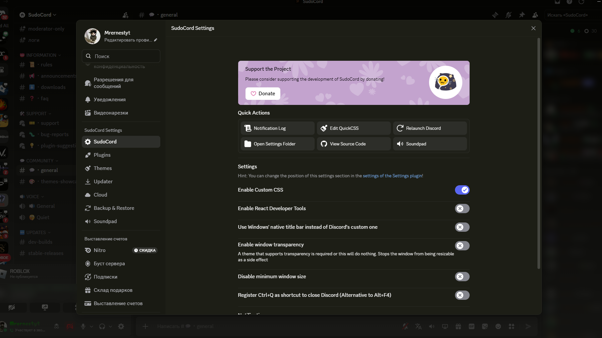

<div align="center">


# SudoCord

**A Discord client mod with 500+ plugins: Vencord, Equicord and Nightcord in one client, plus SudoCord's own plugins.**

[](https://github.com/Ernest1101/Sudocord/releases/latest)
[](https://github.com/Ernest1101/Sudocord/releases)
[](https://github.com/Ernest1101/Sudocord/actions/workflows/stable.yml)
[](LICENSE)

[**Download**](https://sudocord.mooo.com/download) ·
[Website](https://sudocord.mooo.com) ·
[Changelog](CHANGELOG.md) ·
[Report a bug](https://github.com/Ernest1101/Sudocord/issues/new/choose)

<br />



</div>

---

## ✨ Why SudoCord

|  |  |
| --- | --- |
| 🧩 **Three plugin collections, one client** | Every Vencord plugin, plus 200+ from Equicord and 140+ from Nightcord. Each card shows which client the plugin comes from, and you can filter by it. |
| ⚡ **SudoCord's own plugins** | Custom backgrounds (images and video), voice subtitles with translation, stream quality unlock, staff alerts and more. See the [list below](#-sudocord-plugins). |
| 🎨 **Themes and backgrounds** | A SudoCord Themes tab with one-click install, a font picker and one-click video backgrounds. |
| 🔄 **Updates that always arrive** | One-click updates. If GitHub is slow or blocked, the updater and the installer download from the sudocord.mooo.com mirror instead. |
| 🖥️ **Every desktop** | Windows, Linux (X11 and Wayland) and macOS, all through the Sudotl installer. |

## 📥 Install

### Windows

1. Download **[Sudotl.exe](https://github.com/Ernest1101/Sudotl/releases/latest/download/Sudotl.exe)**. If GitHub doesn't open for you, use the [mirror](https://sudocord.mooo.com/releases/files/Sudotl/Sudotl.exe).
2. Close Discord, run the installer and press **Install**.
3. Start Discord. The **SudoCord** section is now in your settings.

### Linux

```sh
sh -c "$(curl -sS https://sudocord.mooo.com/install.sh)"
```

The script chooses the X11 or Wayland build automatically. Add `sh --cli` after the closing quote for the command-line installer.

### macOS

Download the installer from the [download page](https://sudocord.mooo.com/download): Apple Silicon or Intel.

> [!TIP]
> Discord stuck on **"Starting"**, or the updater not moving? Run the installer again with Discord closed and press **Reinstall / Repair**.

## 🔌 SudoCord plugins

| Plugin | What it does |
| --- | --- |
| 🖼️ **CustomBackground** | Your own image or video behind the whole client, including the chat, lists and call screen |
| 🔤 **FontSelector** | Pick the client font from the Themes tab |
| 💬 **VoiceSubtitles** | Live subtitles for your voice channel with translation (Groq Whisper). Only Discord's audio is captured |
| 🎥 **StreamQuality** | Custom FPS, resolution and bitrate for Go Live |
| 🚨 **StaffDetector** | Sound and overlay alert when staff joins your voice channel, shown on top of games too |
| 🎵 **GeniusLyrics** | The current Spotify lyric line as your Discord status |
| 🔊 **Soundpad** | Soundboard tab that plays sounds through your microphone |
| 📉 **DecibelLimiter** | Automatically turns down audio that gets too loud |
| 📱 **SpoofPlatform** | Choose the device others see: PC, phone, browser, console or VR |
| 🛡️ **FakeAdmin** | Shows admin controls on your client only. The server still checks your real permissions |
| 📝 **FakeMessages** | Messages only you can see, shown in DMs as if the other person sent them |
| ⌨️ **FakeTyping** | Keeps you "typing..." in chosen channels |
| 🎧 **FakeDeafen** | Look deafened while still hearing the call |
| 🌩️ **TrollStream** | Turns your screen share on and off in a loop |
| 🏷️ **SudoBadges** | SudoCord badge on your profile |
| 👁️ **LastSeen** | When a user was last online |
| ⬆️ **UpdateButton** | Check for updates and update with one button next to the inbox |

> [!NOTE]
> **FakeAdmin** and **FakeMessages** only change what **your** client shows. SpoofPlatform, FakeTyping and TrollStream are visible to other people.

## 🛠️ Build from source

You need [Node.js](https://nodejs.org) 22+, [pnpm](https://pnpm.io) and [Git](https://git-scm.com).

```sh
git clone https://github.com/Ernest1101/Sudocord
cd Sudocord
pnpm install

pnpm build    # build the client
pnpm inject   # patch your Discord install
```

Restart Discord fully after injecting. Run `pnpm watch` while you work on a plugin. Your own plugins go in `src/userplugins/`.

## ❤️ Credits

SudoCord is a fork of **[Vencord](https://github.com/Vendicated/Vencord)** by Vendicated and contributors. It also includes plugins from **[Equicord](https://github.com/Equicord/Equicord)** and **Nightcord**. Thanks to everyone behind them. Original copyright headers are kept.

## 📄 License

[GPL-3.0-or-later](LICENSE), same as Vencord.

<div align="center">
<sub>SudoCord is not affiliated with or endorsed by Discord. Client mods break Discord's Terms of Service, so use them at your own risk.</sub>
</div>
